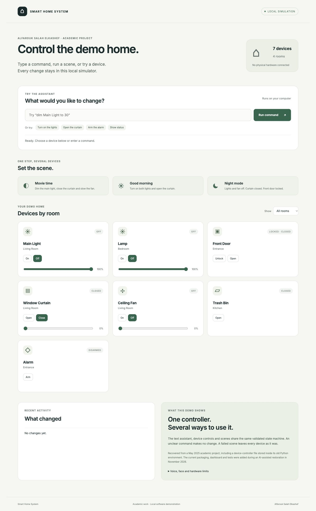

# Smart Home System

A local smart-home demonstration based on Alfarouk Salah Elkashef's academic
project. It brings text commands, room controls, device state and scenes into
one testable controller. You can run it on a laptop without a microphone,
camera, Raspberry Pi, Arduino or online AI account.

**The dashboard is a simulator. It never controls a real door or alarm.**



## Try it

Use Python 3.12 or newer. The core has no runtime dependencies.

```bash
python -m venv .venv
```

Activate it on macOS/Linux with `source .venv/bin/activate`, or on Windows
PowerShell with `.venv\Scripts\Activate.ps1`. Then:

```bash
python -m pip install -e .
smart-home serve
```

Open [127.0.0.1:8766](http://127.0.0.1:8766). Stop the server with Control+C.
It listens only on your computer. No account or API key is needed.

```bash
smart-home console
smart-home command "dim Main Light to 30"
smart-home status
```

Each command starts a fresh simulation unless you choose a state file:

```bash
smart-home --state-file state.json command "turn on the lights"
smart-home --state-file state.json serve
```

The simulator's unlock/disarm code is **2468**. You can replace it through
`SMART_HOME_CONTROL_CODE`. It is a demo control, not a security credential for
a real home. Codes are not saved in state or command logs.

## What works

| Area | Examples |
| --- | --- |
| Lights | On/off, brightness, color; all lights or a named room/device |
| Doors | Lock/unlock, open/close, five-second simulated auto-close |
| Curtains | Open/close and percentage position |
| Fan | On/off and percentage speed |
| Bin | Open/close and three-second simulated auto-close |
| Alarm | Arm/disarm, with door-state and control-code checks |
| Scenes | Movie time, good morning, night mode; validated as one transaction |
| Device setup | Add/remove configured devices and save named scenes through the CLI or Python API |
| State | Explicit optional JSON persistence, atomic saves, readable errors |

Try `turn on lights in Bedroom`, `open Window Curtain`, `set Ceiling Fan speed
to 40`, `activate scene movie time` or `help`. Commands must be direct. A typo
may produce a suggestion, but fuzzy matching never operates a device.

The current parser is a small explicit grammar. It does not use a large
language model or claim general language understanding.

## Optional features

These use separate extras so a missing audio or camera library cannot break
the core demo.

### Offline speech

```bash
python -m pip install '.[voice]'
smart-home voice --audio-file your-command.wav
```

For a microphone, install PortAudio through your operating system, then
`python -m pip install '.[microphone]'` and run `smart-home voice`. Recognition
uses PocketSphinx locally. Begin with **“home assistant”**, followed by the
command. It records at most seven seconds and does not send
audio to Google. Voice input does not silently supply an unlock/disarm code.
See [hardware and optional features](docs/hardware.md) for platform details.

To read responses aloud, install `'.[tts]'` and add `--speak` to voice mode.
`smart-home speak "Lights are on in the simulator" --output-audio response.aiff`
tests speech output by saving a file without playing it. Audio-driver work has
a timeout and stays outside the controller process.

### Configure devices and scenes

Use the optional state file when you want changes to survive separate commands:

```bash
smart-home --state-file state.json config export home.json
smart-home --state-file state.json config import home.json
smart-home --state-file state.json device add new-device.json
smart-home --state-file state.json scene save study study-scene.json
smart-home --state-file state.json scene remove study
smart-home --state-file state.json device remove desk
```

The JSON shapes and a complete Python API example are in the
[feature and interface guide](docs/feature-matrix.md). Invalid configuration
does not replace the last valid state. A device referenced by a scene cannot
be removed until that reference is removed.

### Face comparison

```bash
python -m pip install '.[face]'
python -m smart_home.models models
smart-home face-compare your-consented-reference.jpg your-consented-probe.jpg
```

This optional restoration feature compares one face in each local image with
OpenCV YuNet and SFace. Models are downloaded explicitly from a pinned OpenCV
Zoo commit and checked by size and SHA256. Images and embeddings are not
stored. **A comparison does not unlock a door.** It provides no liveness,
spoof-resistance or real access-control validation.

### Serial transport check

```bash
python -m pip install '.[serial]'
smart-home serial-loopback
```

This sends and reads a bounded JSON frame through pySerial's in-memory
`loop://` port. It verifies software framing, not Arduino wiring or a physical
actuator. The new serial adapter is separate from the simulator; no serial
port is opened by the dashboard. See the documented protocol before using an
actual controller.

## Run the checks

```bash
python -m pip install -e '.[serial,dev]'
python -m unittest discover -s tests -v
ruff check src tests
python -m build
```

If you use uv, `uv sync --locked --extra serial --extra dev` installs the
committed cross-platform lock. Optional voice, TTS and face extras remain
separate. `uv lock --check` verifies that the lock matches the project.

Tests cover the command-to-state flow, all device families, refused commands,
door/alarm policies, atomic scene failure, persistence failure, timer behavior,
configuration validation, HTTP requests, local-origin boundaries and optional
serial framing. CI also checks supported Python versions. A passing software
test is not evidence of a physical installation.

## Where the project came from

Farouk reports leading planning and coordination for a 20-person team in
May 2025, implementing a Python voice assistant on a Raspberry Pi 5, coordinating
Arduino serial communication, and working on facial access control and system
integration. These are his reported contributions, not a claim that this
archive alone proves every hardware or camera feature.

The supplied archive contains two first-party software branches: a phrase
analyzer with a lights/door/alarm simulator, and a larger configurable
device/scene/voice controller. The larger file was stored inside the old
Windows virtual environment and was recovered during review. That environment
is not shipped or executed here.

The supplied source does not include an implemented facial module, Raspberry
Pi GPIO driver, Arduino serial driver, wiring diagrams or firmware. Missing
files do not establish that those parts never existed. The current dashboard,
packaging, tests, state-machine repair, offline voice path, face-comparison
module and serial diagnostic were added in an **AI-assisted restoration on
3 November 2026**. They should not be presented as independently authored
May 2025 code.

Read [provenance and contribution boundaries](docs/provenance.md),
[architecture](docs/architecture.md), [restoration notes](docs/restoration.md)
and [handover](docs/handover.md) before presenting or extending the work.
The [feature matrix](docs/feature-matrix.md) maps both recovered source branches
to their current interfaces and marks intentional changes.

## License and credits

The original academic archive included no license or contributor agreement.
Alfarouk and his team retain their respective contributions; this repository
does not invent sole authorship or relicense their work. See [LICENSE.md](LICENSE.md).
Optional dependencies and downloaded models keep their own licenses. No
third-party environment or model weights are bundled into this repository.
