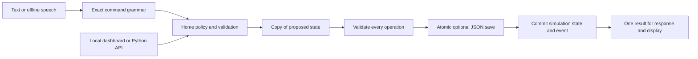

# How the controller works

`Home` owns all state. The parser never mutates it. Both a text command and a
dashboard button become the same typed `Operation`. A scene becomes an ordered
list of operations and either commits completely or makes no change.

This avoids the old separation between an action string and an independently
generated success message. A refused action now produces a refused result in
every interface. The user sees the same state and explanation.

## State and persistence

Device ids are stable, separate from names. Device kinds have explicit commands
and value ranges. Doors start closed and locked; the alarm starts disarmed.
An open door cannot be locked. An armed alarm prevents opening/unlocking a
door. Unlock and disarm require the simulator code.

Auto-close is evaluated against an injected clock when state is read or a
command runs. It does not launch background timer threads. The dashboard polls
once per second, so an elapsed deadline becomes visible without another user
command. Auto-close does not pretend to relock the door.

By default state is in memory. An explicit state file is written to a temporary
file, flushed, then atomically replaced. A corrupt file is rejected without
overwriting it. A save failure prevents a success response and leaves the
in-memory transaction unchanged. Runtime activity and codes are not written
into the project or exposed as public repository data.

## Local dashboard boundary

The standard-library HTTP server accepts only loopback binding. It serves
three named static assets rather than a directory tree. JSON requests have a
small body limit, Host/Origin checks and no permissive CORS response. A content
security policy keeps scripts and connections local. DOM text is set with
`textContent`, not interpolated into HTML.

This is a local demonstration server, not a hardened internet service. Python's
[HTTP server documentation](https://docs.python.org/3/library/http.server.html)
also warns against treating `http.server` as a production server.

## Optional boundaries

Audio packages load only when voice mode is selected. PocketSphinx recognizes
locally; the previous implicit Google request was removed. The face module
loads OpenCV only when requested and produces a comparison result, never a
door operation. Serial diagnostics require an explicit extra and explicit
local port. None of these adapters is imported by normal text/dashboard mode.

The dashboard compares both a per-process instance id and the state revision.
A restarted server therefore refreshes an already-open page even if its new
revision counter happens to equal the previous server’s counter.
